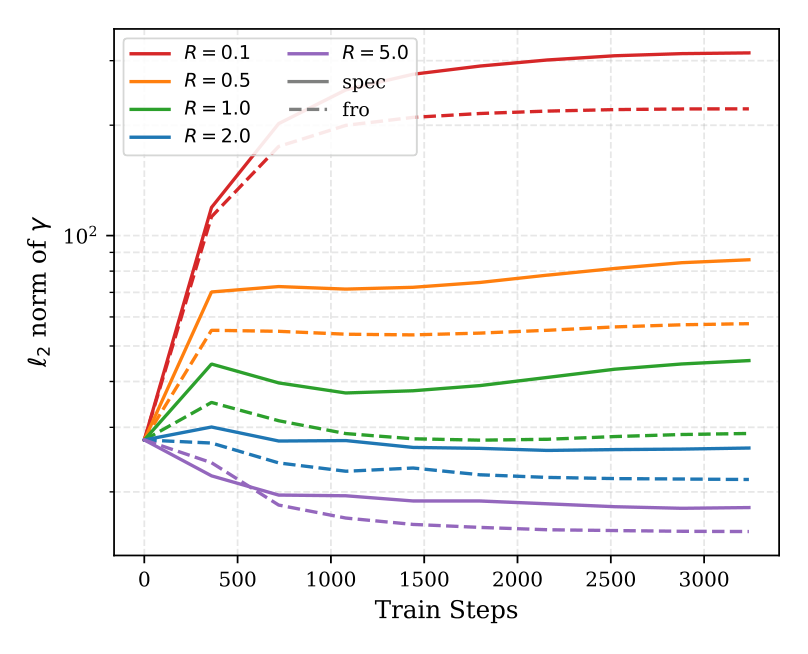

LLM training is essentially a nonconvex minimization problem. In classical optimization, we do line search to make sure gradient descent method converges. In LLM training, line search is prohibitive. Therefore, there is no way to guarantee the convergence. For this reason, researchers have developed many heuristics to stabilize the training dynamics in the hope that the training will not diverge. These heuristics include normalization layers, weight decay, gradient clipping, and careful learning-rate schedules (e.g., warmup).

Muon achieves this goal by normalizing the momentum so that the update is always controlled. More specifically, Muon updates the weight matrix $W$ by 
$$
W_{t+1} = W_t - \eta_t \operatorname{msign}(M_t),
$$
where $M_t$ is the momentum and $\operatorname{msign}$ is the matrix sign operator, which normalizes all singular values of the momentum to 1.

The success of Muon suggests that normalizing the update is a good way to stabilize the training. This motivates to ask a natural question: **what if we also normalize the weights?**

That is the starting point of our paper, [*Demystifying Manifold Constraints in LLM Pre-training*](https://arxiv.org/abs/2605.04418v2). We study what happens when LLM training explicitly constrains weight matrices to manifolds. Our algorithm, **MACRO**, essentially a Riemannian spectral gradient descent method, solves the manifold-constrained LLM training with rigorous convergence guarantees. 

## Muon: normalizing the momentum

A neural-network linear layer maps an input vector $x$ to $Wx$, with

$$
W\in\mathbb R^{d_{\mathrm{out}}\times d_{\mathrm{in}}}.
$$

Treating the weights as a matrix leads to matrix-aware optimizers, including Shampoo, SOAP, ASGO, and Muon.

In a simplified form of Muon, the stochastic gradient and momentum are

$$
G_t=\nabla_W\ell(W_t,\xi_t),
\qquad
M_t=\beta M_{t-1}+(1-\beta)G_t.
$$

Rather than using $M_t$ directly, Muon updates the weights using the matrix sign of $M_t$:

$$
O_t=\operatorname{msign}(M_t),
\qquad
W_{t+1}=W_t-\eta_t O_t.
$$

## Manifold Muon: normalizing the momentum and the weights 

Early contributors of Manifold Muon are Jeremy Bernstein [^ManifoldMuon], Jianlin Su [^Jianlin], and Franz Louis Cesista [^Franz]. It suggests normalizing the weights in addition to the momentum. Since weights are the decision variables of the optimization problem, normalizing them requires imposing constraints on them. This changes the original unconstrained optimization problem into a constrained one, in fact, a Riemannian optimization problem: 

$$
\min_{W\in\mathcal M}\mathcal L(W), 
$$
where $\mathcal M$ is a manifold. 

There are two questions: which manifold to use and how to solve the manifold-constrained optimization problem? 

Our **MACRO** algorithm, a Riemannian spectral gradient descent method (Riemannian Muon), provides an algorithmic framework for solving this problem. The main updates of MACRO are: 
$$
\begin{aligned}
G_t &= \nabla_W\ell(W_t,\xi_t),\\
M_t &= \beta M_{t-1}+(1-\beta)G_t,\\
\Phi_t &= \operatorname{proj}_{T_{W_t}\mathcal M}(M_t),\\
O_t &= \operatorname{msign}(\Phi_t),\\
D_t &= R\,\frac{O_t}{\|O_t\|_{\mathcal M}+\epsilon},\\
W_{t+1} &= \mathcal P_{\mathcal M}(W_t-\eta_tD_t).
\end{aligned}
$$
Here $\operatorname{proj}_{T_{W_t}\mathcal M}$ is the projection onto the tangent space, and $\mathcal P_{\mathcal M}$ serves the purpose of retraction. They are standard operations in Riemannian optimization. MACRO has the following convergence rate guarantee under standard assumptions: 
$$
\min_{t=0,\ldots,T-1}\mathbb{E}\|\nabla_\mathcal{M}\mathcal{L}(W_t)\|_* \leq \mathcal{O}(T^{-1/4}),
$$
which matches the rate for general nonconvex smooth stochastic optimization. 

Since Muon essentially projects the momentum on to Stiefel manifold, one would think that it is natural to impose Stiefel manifold to the weights. However, manifold Muon with Stiefel manifold doesn't scale well. Two natural alternatives are Frobenius norm sphere and Spectral norm sphere (although technically spectral norm sphere is not a manifold): 

$$
\mathcal M_F(R)=\{W:\|W\|_F=R\}, \quad \mathcal M_S(R)=\{W:\|W\|_2=R\}.
$$

Existing works such as Spectral Sphere Optimization (SSO) [^SSO] uses spectral sphere, while MuonH [^MuonH] adopts Frobenius sphere. 

## Spectral and Frobenius constraints need different radii

Choosing the norm is only half the specification. **What radius should we use?**

Consider a sequence of $s$ input vectors collected in $X\in\mathbb R^{s\times d_{\mathrm{in}}}$, with

$$
Y=XW^\top.
$$

Define the input and output root-mean-square scales by

$$
\operatorname{RMS}(X)=\frac{\|X\|_F}{\sqrt{s\,d_{\mathrm{in}}}},
\qquad
\operatorname{RMS}(Y)=\frac{\|Y\|_F}{\sqrt{s\,d_{\mathrm{out}}}}.
$$

We want to choose a radius such that the RMS norm is preserved from $X$ to $Y$.

### Spectral sphere controls the worst-case scale

The operator-norm bound gives

$$
\operatorname{RMS}(Y)
\leq
\sqrt{\frac{d_{\mathrm{in}}}{d_{\mathrm{out}}}}
\|W\|_2\operatorname{RMS}(X).
$$

Thus, with

$$
R_{\mathrm{spec}}=r\sqrt{\frac{d_{\mathrm{out}}}{d_{\mathrm{in}}}},
$$

we obtain $\operatorname{RMS}(Y)\leq r\operatorname{RMS}(X)$. This bound holds for arbitrary input directions: it controls the largest possible amplification. 

### Frobenius sphere controls an average-case scale

Using the Frobenius norm in that same worst-case inequality gives a much looser bound. A better way is to examine an isotropic-input calculation at initialization. For a fixed layer weight and input vectors satisfying $\mathbb E[x_i x_i^\top]=\sigma_x^2I$, a direct expansion gives

$$
\mathbb E\|XW^\top\|_F^2
=s\sigma_x^2\|W\|_F^2.
$$

Consequently,

$$
\left(\mathbb E[\operatorname{RMS}(Y)^2]\right)^{1/2}
=
\frac{\sigma_x}{\sqrt{d_{\mathrm{out}}}}\|W\|_F.
$$

This motivates

$$
R_{\mathrm{fro}}=r\sqrt{d_{\mathrm{out}}}.
$$

The practical choices are therefore

| Constraint | Radius |
|:--|:--|
| Spectral sphere | $r\sqrt{d_{\mathrm{out}}/d_{\mathrm{in}}}$ |
| Frobenius sphere | $r\sqrt{d_{\mathrm{out}}}$ |

The multiplier $r$ is a tunable scalar. Our numerical experiments show that MACRO is not sensitive to the choice of $r$.


## Manifold constraint functionally overlaps with RMSNorm

Normalization layers already control activation scale. For example, RMSNorm takes the form

$$
\operatorname{RMSNorm}_{\gamma}(x)
=
\gamma\odot\frac{x}{\operatorname{RMS}(x)},
$$

where $\gamma$ is a learned scale vector. The manifold constraints also have regulation effects on activation scale through the control of weights norm. The two mechanisms may have some functional overlap. 

That is what we observed: increasing the prescribed constraint radius is accompanied by a decrease in the learned norm of $\gamma$. The figure below illustrates this relationship.

{fig-alt="Plot of the norm of the learned RMSNorm scale vector during training for several radius settings. Larger radii correspond to smaller learned scale-vector norms." width=75%}

This suggests **functional overlap**. In the standard architecture, learnable normalization can buffer changes in weight scale. 

We also ask what happens after removing standard learnable pre-RMSNorm layers. This experiment retains targeted parameter-free normalizations after embedding and attention, QK normalization, and Norm-Gated SwiGLU. For a 330M QWen-like model, our results are:

| Optimizer | Validation loss at LR $0.01$ | Validation loss at LR $0.03$ |
|:--|--:|--:|
| Muon | 2.813 | NaN |
| MACRO-fro | 2.758 | 2.781 |
| MACRO-spec | 2.739 | 2.819 |

Both MACRO variants remain stable at the largest tested learning rate, while Muon fails when LR=$0.03$. The conclusion is: explicit manifold constraints can take over part of the stabilization role of learnable normalization, within this particular architecture.

## Weight decay is not needed in manifold Muon 

### What weight decay is doing geometrically

Consider the decoupled weight-decay update

$$
W_{t+1}=(1-\eta_t\lambda)W_t-\eta_tD_t.
$$

When decay-induced shrinkage offsets the norm growth caused by optimization updates, the weight norm can settle around an approximately stable level. Learning continues, but the motion increasingly resembles a **rotation**: the direction of the weights changes while their overall size remains approximately constant. This is the so-called *rotational equilibrium*.

However, to achieve this effect, the optimizer must evolve toward an equilibrium, potentially through a long transient in which weight norms and angular updates are still changing. Choosing a decay coefficient does not prescribe the weight norm or the rotation angle at every iteration.

**Rather than waiting for this balance to emerge, can we impose the desired geometry from the first step?**

### MACRO fixes the scale directly

The Frobenius sphere gives the clearest illustration. MACRO-fro enforces

$$
\|W_t\|_F=R
$$

throughout training. Let $O_t$ be MACRO’s matrix-sign direction, computed from the tangent-projected momentum. Omitting the numerical stabilizer and assuming a nonzero direction, its normalized step is

$$
\begin{aligned}
\widetilde{\nabla}_t&=R\frac{O_t}{\|O_t\|_F},\\
Z_t&=W_t-\eta_t\widetilde{\nabla}_t,\\
W_{t+1}&=R\frac{Z_t}{\|Z_t\|_F}.
\end{aligned}
$$

Both the weight and the normalized direction have Frobenius norm $R$. Therefore,

$$
\boxed{
\frac{\|\eta_t\widetilde{\nabla}_t\|_F}{\|W_t\|_F}
=\eta_t.
}
$$

The learning-rate schedule now directly controls the **proposed update-to-weight ratio**, without depending on a weight norm that drifts during training. 

There is no need for an additional shrinkage term to maintain the prescribed weight scale: the normalization already does that at every iteration.

### From fixed weight norms to controlled rotation

Because consecutive weights have the same Frobenius norm, their movement can be described by the angle

$$
\theta_t=
\arccos\!\left(
\frac{\langle W_{t+1},W_t\rangle_F}{R^2}
\right).
$$

Here we regard each weight matrix as a vector of its entries. This is a global angle between two matrices, not a claim that every singular direction rotates by the same amount.

Our analysis makes this angle explicit. Define

$$
\alpha_t=
\frac{\langle W_t,O_t\rangle_F}
{R\|O_t\|_F}.
$$

The normalized update gives the exact identity

$$
\boxed{
\cos\theta_t=
\frac{1-\eta_t\alpha_t}
{\sqrt{1-2\eta_t\alpha_t+\eta_t^2}}.
}
$$

For small steps,

$$
\theta_t\approx\eta_t\sqrt{1-\alpha_t^2}.
$$

When the update direction is nearly tangent, $\alpha_t\approx0$, this becomes **$\theta_t\approx\eta_t$**. 

### Do we still need weight decay in practice?

We test this directly on a **330M Qwen3-like model**, comparing weight-decay coefficients $\lambda=0$ and $\lambda=0.1$ while keeping the other settings fixed at each learning rate. 

| Optimizer | Weight decay | LR 0.007 | LR 0.01 | LR 0.03 |
|:--|--:|--:|--:|--:|
| MACRO-fro | 0 | 2.742 | 2.730 | 2.718 |
| MACRO-fro | 0.1 | 2.742 | 2.729 | 2.718 |
| MACRO-spec | 0 | 2.728 | 2.715 | 2.783 |
| MACRO-spec | 0.1 | 2.727 | 2.715 | 2.783 |

*Validation loss; lower is better. These are the separate 330M weight-decay ablation results.*

The differences are at most **0.001**. So, adding weight decay provides essentially no additional benefit.

## Low-precision training

The following table reports final validation perplexities:

| Model | Optimizer | FP32 configuration | BF16 configuration |
|:--|:--|--:|--:|
| 240M | Muon | 20.593 | 64.845 |
| 240M | MACRO-fro | 20.494 | 20.748 |
| 240M | MACRO-spec | 20.732 | 21.324 |
| 600M | Muon | 15.349 | 39.269 |
| 600M | MACRO-fro | 15.296 | 15.665 |
| 600M | MACRO-spec | 15.310 | 16.056 |

The contrast is substantial: MACRO incurs far less degradation in these reduced-precision settings. 

## What happens in standard pretraining?

The main experiments use Qwen3-like decoder-only Transformers, with grouped-query attention, rotary position embeddings, SwiGLU, and pre-RMSNorm. **“Qwen3-like” describes the architecture.** These models are trained from scratch. 

The sequence length is 2,048, and the global batch size is 512. The validation-perplexity is reported in the table below. 

| Optimizer | 240M | 600M | 1.2B |
|:--|--:|--:|--:|
| Muon | $20.72\pm0.010$ | $15.37\pm0.006$ | $12.99\pm0.004$ |
| MuonH-fro | $20.55\pm0.007$ | $15.23\pm0.006$ | $12.92\pm0.005$ |
| MuonH-spec | $20.63\pm0.014$ | $15.33\pm0.006$ | $12.88\pm0.006$ | 
| SSO | $20.59\pm0.021$ | $15.32\pm0.007$ | — |
| MACRO-fro | $20.58\pm0.011$ | $15.29\pm0.002$ | $12.85\pm0.006$ |
| MACRO-spec | $20.50\pm0.011$ | $15.30\pm0.005$ | $12.90\pm0.009$ |

Both MACRO variants improve on the reported Muon baseline at each scale. The differences between spectral and Frobenius constraints are modest, and MACRO is competitive with MuonH.

## We no longer need learning-rate warmup 

**Learning-rate warmup** starts training with a small learning rate and gradually increases it to the target level. Results in the following table show that the learning rate warmup is no longer needed when we use MACRO. 

**240M model**

| Warmup ratio | Muon | MACRO-fro | MACRO-spec |
|:--|--:|--:|--:|
| 0% | 20.868 | **20.543** | **20.559** |
| 5% | **20.650** | 20.560 | 20.632 |
| 10% | 20.679 | 20.604 | 20.700 |
| 15% | 20.712 | 20.674 | 20.752 |

**600M model**

| Warmup ratio | Muon | MACRO-fro | MACRO-spec |
|:--|--:|--:|--:|
| 0% | 15.312 | **15.227** | **15.216** |
| 5% | **15.309** | 15.252 | 15.253 |
| 15% | 15.402 | 15.340 | 15.354 |


**Both MACRO variants perform best without warmup at both model sizes.** Muon achieves its best performance when 5% training steps are used for learning rate warmup.

## Conclusion

Manifold constraints help improve significantly the training stability. When using manifold constraints, weight decay is no longer needed, so one less hypterparameter to tune in practice. Moreover, learning rate warmup is not needed either. Our manifold Muon algorithm, MACRO, is very robust to low-precision training. 

## Paper and codes 

Kang An, Jiaxiang Li, Donald Goldfarb, and Shiqian Ma. **Demystifying Manifold Constraints in LLM Pre-training.** arXiv:2605.04418, 2026. [Paper](https://arxiv.org/abs/2605.04418v2).

Our codes are available at [titanprecond](https://github.com/ErstinAn/titanprecond).

## Cite this paper

To cite this work, please use the following BibTeX entry:

```bibtex
@misc{an2026demystifying,
  title         = {Demystifying Manifold Constraints in {LLM} Pre-training},
  author        = {An, Kang and Li, Jiaxiang and Goldfarb, Donald and Ma, Shiqian},
  year          = {2026},
  archivePrefix = {arXiv},
  url           = {https://arxiv.org/abs/2605.04418}
}
```

[^ManifoldMuon]: [Jeremy Berstein's blog](https://thinkingmachines.ai/blog/modular-manifolds/) 

[^Jianlin]: [Jianlin Su's blog](https://kexue.fm/archives/11221)

[^Franz]: [Franz Louis Cesista's blog](https://leloykun.github.io/ponder/steepest-descent-stiefel/)

[^SSO]: [SSO](https://arxiv.org/abs/2601.08393)

[^MuonH]: [MuonH](https://psychedelic-sunstone-851.notion.site/Fantastic-Pretraining-Optimizers-and-Where-to-Find-Them-2-1-Hyperball-Optimization-2e924306e6f280e7a5ffee00eb40a0dd)
